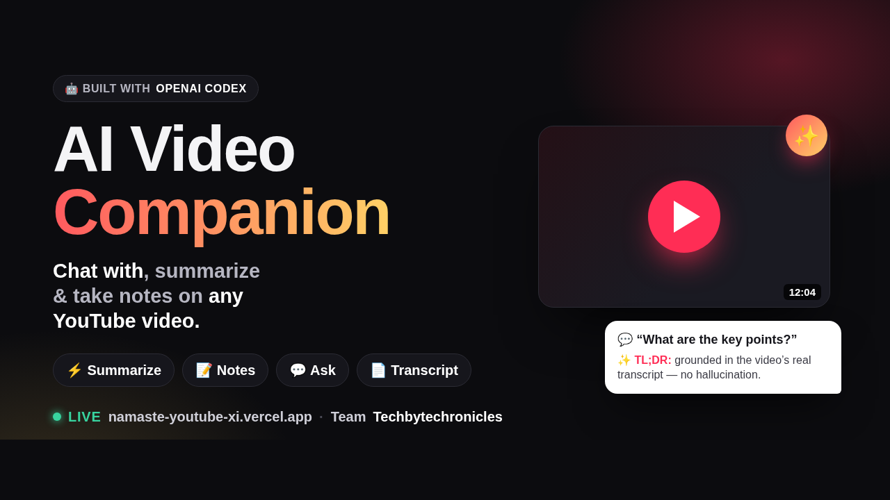
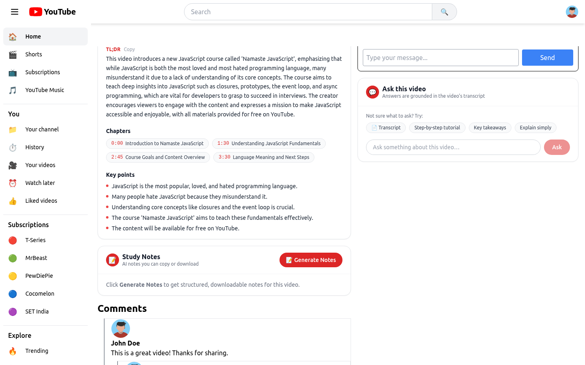
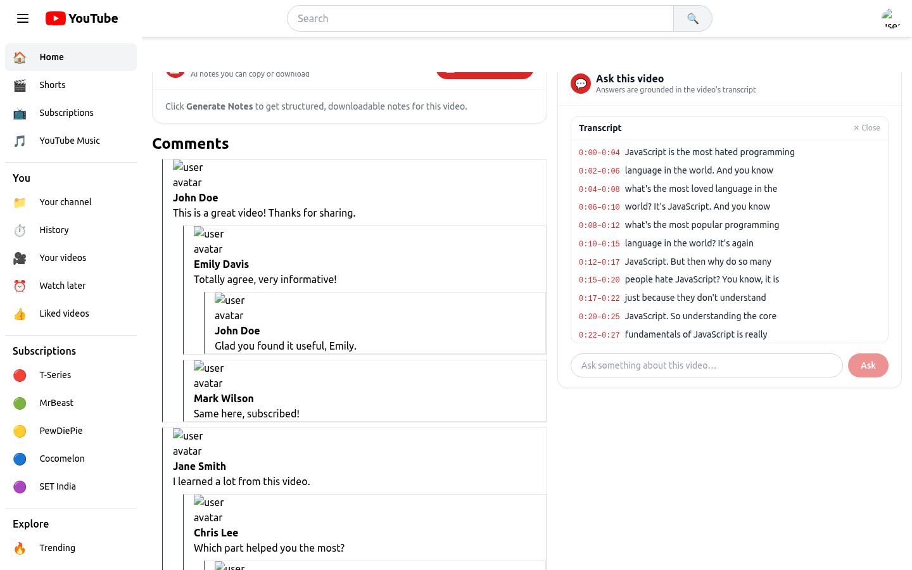
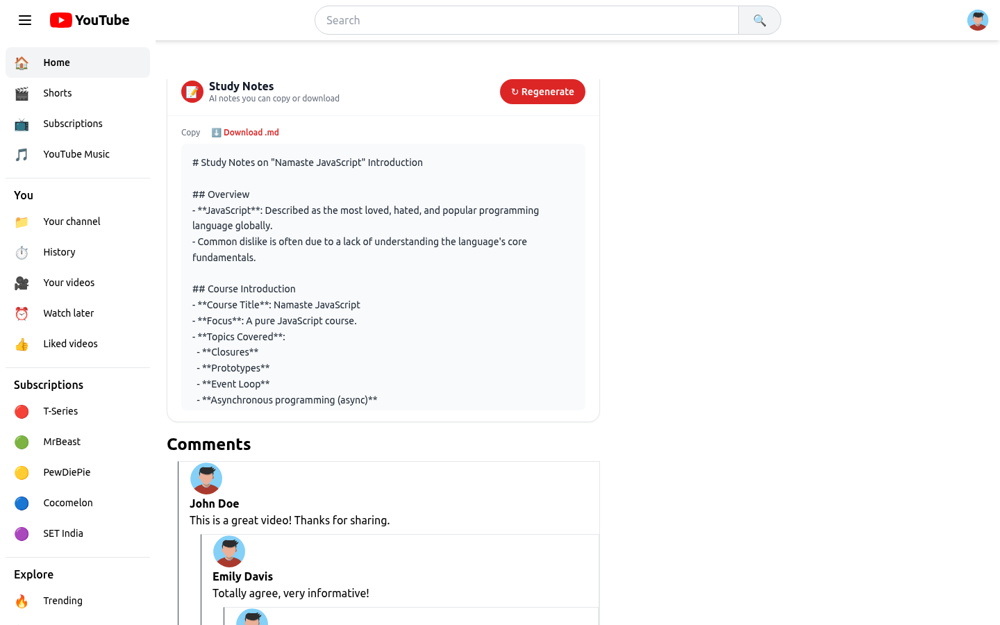
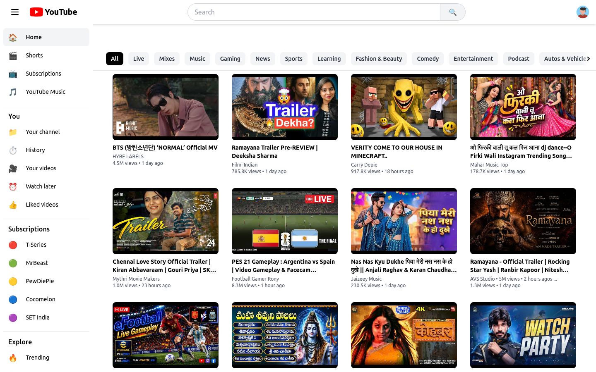
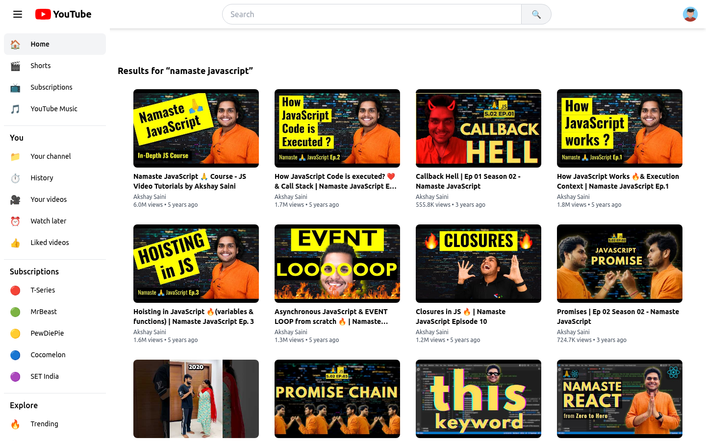
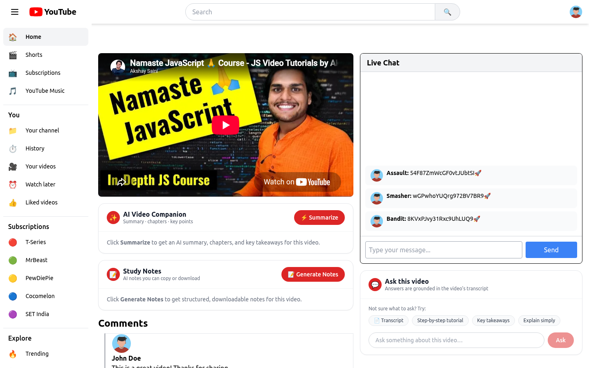

# 🎬 AI Video Companion

> A full **YouTube-style app** — trending feed, search, watch page, live chat, nested comments — supercharged with an **AI layer** that lets you **summarize, take notes, and chat with any video**, all grounded in the video's real transcript.

**🔗 Live demo:** https://namaste-youtube-xi.vercel.app
**Built for:** OpenAI × NamasteDev **Codex** Hackathon · **Team Techbytechronicles**

<p align="center">
  
</p>

---

## Overview
This project is two things in one:
1. A complete **YouTube clone** (feed, search, watch, live chat, recursive comments) built with React 19 + Redux Toolkit + Tailwind.
2. An **AI Video Companion** layer added on the watch page that turns any video into something you can *read, search, and ask.*

**The problem it solves:** videos are long. Finding the gist, the steps, or the answer to a single question means scrubbing through minutes of content. AI Video Companion gives you that instantly.

---

## ✨ Features

### 🤖 AI Video Companion (hackathon highlight)
- ⚡ **Summarize** — TL;DR + auto-generated **chapters with timestamps** + key points.
- 💬 **Ask the video** — chat-style Q&A answered **only from the transcript** (no hallucination), with follow-up suggestion chips and a scrollable, auto-scrolling chat.
- 📝 **Study Notes** — structured Markdown notes you can **copy or download as `.md`**.
- 📄 **Transcript** — the full, timestamped transcript on screen.

### 📺 YouTube clone (the base it's built on)
- **Trending video feed** — top popular videos via the **YouTube Data API v3**, in a responsive card grid with formatted view counts and relative timestamps.
- **Category filter bar** — horizontally scrollable pill filters (All, Music, Gaming, News, Sports, Learning…) with dynamic scroll arrows.
- **Collapsible sidebar** — full navigation, toggled by the hamburger menu, state managed globally via Redux.
- **Debounced search with caching** — suggestions from the Google Suggest API with a 200 ms debounce, cached in Redux so repeat queries skip the network.
- **Watch page** — embedded player + a YouTube-style two-column layout (video/AI on the left, live chat + Ask on the right).
- **Live chat** — a simulated live-chat panel (auto-messages via `setInterval`) where you can also post your own messages.
- **Recursive nested comments** — arbitrarily deep reply trees via a self-referencing component.
- **404 fallback** for unmatched routes.

---

## 📸 Screenshots

<table>
<tr>
<td width="50%"><b>⚡ AI Summary — TL;DR, chapters &amp; key points</b><br></td>
<td width="50%"><b>💬 Ask — grounded in the real transcript</b><br></td>
</tr>
<tr>
<td><b>📝 Downloadable Study Notes (Markdown)</b><br></td>
<td><b>📺 Trending feed (YouTube Data API)</b><br></td>
</tr>
<tr>
<td><b>🔎 Search results</b><br></td>
<td><b>▶️ Watch page (video + AI + live chat)</b><br></td>
</tr>
</table>

---

## 🧠 How the AI works
```
Browser  →  Vercel serverless function  →  fetch transcript (Supadata)  →  OpenAI (gpt-4o-mini)  →  grounded result
```
- **Transcript-grounded:** the model receives *only* the transcript and is told never to invent facts — so answers are trustworthy (it honestly says when info isn't in the video).
- **Keys stay server-side:** all AI calls run inside serverless functions — no API keys in the browser.
- **Mock-first:** runs with no OpenAI key (returns placeholders) and **auto-switches to real AI** once the key is set — zero code change.
- **Cached:** each video's transcript is cached in memory to conserve API calls.

## 🛠️ Engineering highlights (problems we solved)
- **YouTube blocks transcript scraping from cloud IPs.** `youtube-transcript` worked locally but failed on *every* video once deployed to Vercel (datacenter IPs are blocked). We switched to the **Supadata API** (residential proxies) via a shared `lib/transcript.mjs` helper — now it works in production.
- **CRA + CI:** Create React App fails the production build on ESLint warnings when `CI=true` (Vercel's default). Fixed with a `CI=false` build env var.
- **Responsive layout:** used `min-w-0` on the flex video so the live-chat sidebar sits correctly beside it.

---

## 🧰 Tech stack
| Layer | Tech |
|---|---|
| Frontend | React 19, React Router 7, Redux Toolkit, Tailwind CSS (Create React App) |
| Backend | Vercel serverless functions (Node, ESM) |
| AI | OpenAI `gpt-4o-mini` |
| Transcripts | Supadata API |
| Video data | YouTube Data API v3 |
| Search suggestions | Google Suggest API |
| Hosting | Vercel |
| Built with | **OpenAI Codex** |

## 📁 Project structure
```
api/                    Vercel serverless functions
├── summarize.mjs       Summary + chapters + key points
├── ask.mjs             Transcript-grounded Q&A
├── notes.mjs           Study notes (Markdown)
└── transcript.mjs      Timestamped transcript
lib/
└── transcript.mjs      Shared Supadata transcript helper (+ in-memory cache)
src/
├── App.js              Root layout, router, Redux Provider
├── component/
│   ├── Header.jsx          Sticky header: logo, search, avatar
│   ├── SiderBar.jsx        Collapsible sidebar
│   ├── BodyMenuBar.jsx     Category filter bar
│   ├── Body.jsx            Home shell
│   ├── BodyVideosCards.jsx Trending feed (YouTube API)
│   ├── VideoCards.jsx      Video card
│   ├── Watch.jsx           Watch page (video + AI panels + chat + comments)
│   ├── SummaryPanel.jsx    ⚡ AI summary/chapters/key points
│   ├── NotesPanel.jsx      📝 AI study notes (copy/download)
│   ├── AskPanel.jsx        💬 Ask + transcript + chips
│   ├── LiveChat.jsx        Simulated live chat
│   ├── ChatMessages.jsx    Chat message row
│   ├── Comment.jsx         Recursive nested comments
│   └── NotFound.jsx        404
└── utils/
    ├── store.jsx, appSlice.jsx, searchSlice.jsx, chatSlice.jsx, constant.jsx
```

## 🗺️ Architecture notes
**Redux store:** `app.isMenuOpen` (sidebar), `search` (query → suggestions cache), `chat.messages` (capped live-chat list).
**Routing:** `/` (feed) · `/watch?v=<id>` (watch page) · `*` (404).
**Search flow:** type → 200 ms debounce → serve from Redux cache if present, else fetch Google Suggest → cache → render.

---

## 🚀 Run locally
```bash
git clone https://github.com/ankitsaini001/namaste-youtube.git
cd namaste-youtube
npm install
npm i -g vercel        # needed to run the /api functions locally
```
Create a `.env` in the project root:
```env
REACT_APP_YT_API_KEY=your_youtube_data_api_v3_key
OPENAI_API_KEY=your_openai_api_key
SUPADATA_API_KEY=your_supadata_api_key
```
Run it (⚠️ use `vercel dev` — `npm start` runs only the frontend and does **not** serve the `/api` AI endpoints):
```bash
vercel dev
```
Open http://localhost:3000

## ☁️ Deploy (Vercel)
1. Add the three env vars above in **Project → Settings → Environment Variables**.
2. Also add **`CI=false`** (so the CRA build doesn't fail on lint warnings).
3. Deploy: `npx vercel --prod`

---

## 👥 Team — Techbytechronicles
- **Ankit Saini** — https://github.com/ankitsaini001
- **Nasreen Shah**

Built for the OpenAI × NamasteDev Codex Hackathon, July 2026.
